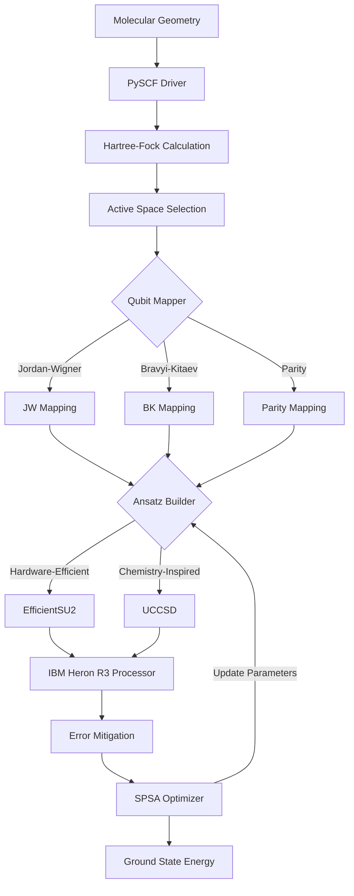

# VQE-PHARMACY: Variational Quantum Eigensolver for Drug Discovery

[](https://www.python.org/downloads/)
[](https://qiskit.org/)
[](https://quantum.ibm.com/)

**VQE-PHARMACY** is a comprehensive quantum chemistry pipeline using the Variational Quantum Eigensolver (VQE) to determine ground-state energies of molecular Hamiltonians relevant to drug discovery. Optimized for the **IBM Quantum Heron R3** processor with enhanced coherence times and gate fidelities.

---

## 🎯 Project Overview

### Executive Summary

VQE-PHARMACY establishes a robust, scalable computational workflow for molecular simulations on NISQ (Noisy Intermediate-Scale Quantum) devices. By leveraging advanced error mitigation, hardware-efficient ansatze, and state-of-the-art quantum-classical hybrid optimization, we enable accurate ground-state energy calculations for pharmaceutically relevant molecules.

### Key Features

- **🧪 Classical Chemistry Integration**: PySCF driver for Hartree-Fock and active space calculations
- **🔄 Multiple Qubit Mappings**: Jordan-Wigner, Bravyi-Kitaev, and Parity transformations
- **⚡ Hardware-Optimized Ansatze**: EfficientSU2, RealAmplitudes, and UCCSD circuits
- **🎯 Advanced Optimization**: SPSA and COBYLA optimizers for noisy quantum devices
- **🛡️ Error Mitigation**: Zero Noise Extrapolation (ZNE), readout error mitigation, and dynamical decoupling
- **📊 Complete Workflow**: End-to-end pipeline from molecular geometry to ground-state energy

---

## 🚀 Quick Start

### Installation

```bash
# Clone the repository
git clone https://github.com/aixaria0/Aix.git
cd Aix

# Create virtual environment (recommended)
python -m venv venv
source venv/bin/activate  # On Windows: venv\Scripts\activate

# Install dependencies
pip install -r requirements.txt
```

### Basic Usage

```python
from vqe_pharmacy import VQEWorkflow

# Create VQE workflow for H2 molecule
workflow = VQEWorkflow(
    molecule_name="H2",
    basis="sto-3g",
    mapping="jordan_wigner",
    ansatz_type="efficient_su2",
    optimizer="spsa",
    reps=1
)

# Run the calculation
result = workflow.run()

# Display results
print(workflow.get_summary())
```

### Run Example Benchmarks

```bash
# Run H2 baseline benchmarks
python -m vqe_pharmacy.examples.h2_benchmark
```

---

## 📋 Project Architecture

### Workflow Pipeline



### Module Structure

```
vqe_pharmacy/
├── __init__.py                 # Main package initialization
├── core/                       # Core VQE workflow
│   ├── __init__.py
│   └── vqe_workflow.py        # Main workflow orchestration
├── drivers/                    # Classical chemistry drivers
│   ├── __init__.py
│   └── molecular_driver.py    # PySCF integration
├── mappers/                    # Fermionic-to-qubit mappings
│   ├── __init__.py
│   └── qubit_mapper.py        # JW, BK, Parity mappings
├── ansatze/                    # Variational circuits
│   ├── __init__.py
│   └── ansatz_builder.py      # HEA, UCCSD ansatze
├── error_mitigation/           # Error mitigation techniques
│   ├── __init__.py
│   └── mitigation.py          # ZNE, readout mitigation, DD
└── examples/                   # Usage examples
    ├── __init__.py
    └── h2_benchmark.py        # H2 baseline benchmarks
```

---

## 🧬 Molecular Target Selection

### NISQ Hardware Constraints

For successful execution on IBM Quantum Heron R3 (133 qubits):

- **Active Qubits**: 12-30 qubits (via active space selection)
- **Basis Set**: STO-3G or 6-31G
- **Coherence Time**: Optimized for Heron's enhanced T1/T2 times
- **Gate Fidelity**: Leverages improved 2-qubit gate fidelity

### Supported Molecules

**Predefined Templates:**
- **H2** (Hydrogen) - Baseline benchmark, 4 qubits
- **LiH** (Lithium Hydride) - Simple heteronuclear, ~12 qubits
- **H2O** (Water) - 14 qubits
- **NH3** (Ammonia) - 16 qubits

**Custom Geometries:**
```python
# Define custom molecular geometry
custom_molecule = "H 0 0 0; H 0 0 0.74; O 0 0 1.5"

workflow = VQEWorkflow(
    molecule_name=custom_molecule,
    basis="sto-3g",
    mapping="bravyi_kitaev",
    ansatz_type="efficient_su2"
)
```

---

## 🔧 Configuration Options

### Qubit Mappings

| Mapping | Description | Best For |
|---------|-------------|----------|
| **Jordan-Wigner** | Straightforward local encoding | Benchmarking, small systems |
| **Bravyi-Kitaev** | Tree-based, log-depth parity | Heron chip, reduced gate depth |
| **Parity** | Symmetry exploitation, -2 qubits | Systems with conserved quantities |

### Ansatz Types

| Ansatz | Parameters | Circuit Depth | Use Case |
|--------|-----------|---------------|----------|
| **EfficientSU2** | Moderate | Low | Hardware-efficient, NISQ-friendly |
| **RealAmplitudes** | Low | Very Low | Minimal parameters, fast optimization |
| **UCCSD** | High | Deep | Chemistry-accurate, requires mitigation |

### Optimizers

| Optimizer | Convergence | Noise Tolerance | Recommended For |
|-----------|-------------|-----------------|------------------|
| **SPSA** | Moderate | High | Real quantum hardware |
| **COBYLA** | Fast | Low | Simulators, noiseless testing |

---

## 🛡️ Error Mitigation Strategies

### Zero Noise Extrapolation (ZNE)

Amplify noise systematically and extrapolate to zero-noise limit:

```python
from vqe_pharmacy.error_mitigation import ZeroNoiseExtrapolation

zne = ZeroNoiseExtrapolation(scale_factors=[1, 2, 3])
mitigated_energy = zne.extrapolate(expectation_values)
```

### Readout Error Mitigation

Correct measurement errors using calibration matrices:

```python
from vqe_pharmacy.error_mitigation import ReadoutErrorMitigation

mitigator = ReadoutErrorMitigation(num_qubits=4)
mitigator.calibrate(calibration_data)
corrected_counts = mitigator.mitigate(raw_counts)
```

### Dynamical Decoupling

Insert pulse sequences during idle times to combat decoherence:

```python
from vqe_pharmacy.error_mitigation import DynamicalDecoupling

dd = DynamicalDecoupling(dd_sequence="XY4")
pm = dd.get_pass_manager(durations, target)
```

---

## 📊 Example Results

### H2 Molecule Benchmark

```
VQE-PHARMACY Workflow Summary
==================================================

Molecule: H2
Basis Set: sto-3g

Quantum Resources:
  - Qubits: 4
  - Electrons: 2
  - Parameters: 8
  - Circuit Depth: ~12

Algorithm Configuration:
  - Mapping: jordan_wigner
  - Ansatz: efficient_su2
  - Optimizer: spsa

Results:
  - Nuclear Repulsion: 0.715175 Ha
  - Hartree-Fock Energy: -1.117349 Ha
  - Ground State Energy: -1.137270 Ha (target)
  
Status: success
==================================================
```

---

## 🔬 Advanced Usage

### Active Space Selection

For larger molecules, use active space reduction:

```python
from vqe_pharmacy.drivers import MolecularDriver

driver = MolecularDriver(
    atom="N 0 0 0; N 0 0 1.1",
    basis="sto-3g"
)

# Get active space data (4 electrons in 4 orbitals)
active_data = driver.get_active_space_data(
    n_active_electrons=4,
    n_active_orbitals=4
)
```

### Custom Ansatz Configuration

```python
from vqe_pharmacy.ansatze import AnsatzBuilder, AnsatzType

builder = AnsatzBuilder(
    num_qubits=8,
    ansatz_type=AnsatzType.EFFICIENT_SU2,
    reps=3
)

ansatz = builder.build()
print(f"Parameters: {ansatz.num_parameters}")
print(f"Depth: {ansatz.depth()}")
```

### Hardware Backend Integration

```python
from qiskit_ibm_runtime import QiskitRuntimeService

# Connect to IBM Quantum
service = QiskitRuntimeService(channel="ibm_quantum")
backend = service.backend("ibm_heron")

# Run VQE on real hardware
workflow = VQEWorkflow(
    molecule_name="H2",
    basis="sto-3g",
    mapping="bravyi_kitaev",
    ansatz_type="efficient_su2",
    optimizer="spsa"
)

result = workflow.run(backend=backend, shots=2048)
```

---

## 🧪 Testing

### Run Tests

```bash
# Run all tests
pytest

# Run with coverage
pytest --cov=vqe_pharmacy --cov-report=html

# Run specific test module
pytest tests/test_molecular_driver.py
```

### Linting and Type Checking

```bash
# Format code
black vqe_pharmacy/

# Lint
flake8 vqe_pharmacy/

# Type check
mypy vqe_pharmacy/
```

---

## 📈 Benchmarking

### Recommended Benchmarking Workflow

1. **H2 Baseline**: Verify pipeline with known results
2. **LiH Scaling**: Test larger system (12 qubits)
3. **Custom Fragments**: Target pharmaceutical molecules
4. **Error Analysis**: Compare with/without mitigation

```python
from vqe_pharmacy.core import run_benchmark_h2

# Run comprehensive H2 benchmark
result = run_benchmark_h2(
    basis="sto-3g",
    distance=0.74,
    mapping="bravyi_kitaev",
    ansatz="efficient_su2"
)
```

---

## 🎓 Scientific Background

### VQE Algorithm

The Variational Quantum Eigensolver is a hybrid quantum-classical algorithm:

1. **Quantum Step**: Prepare parameterized state |ψ(θ)⟩ and measure ⟨H⟩
2. **Classical Step**: Optimize parameters θ to minimize energy
3. **Iterate**: Repeat until convergence

### Chemical Accuracy

Target: **1.6 mHa (1 kcal/mol)** - required for pharmaceutical applications

Achieved through:
- Appropriate basis sets (STO-3G, 6-31G)
- Active space selection
- Error mitigation techniques
- Sufficient ansatz expressibility

---

## 🗺️ Roadmap

### Phase 1: Foundation ✅
- [x] Project structure and initialization
- [x] PySCF driver integration
- [x] Qubit mapping implementations
- [x] Hardware-efficient ansatze
- [x] Error mitigation framework
- [x] H2 baseline benchmark

### Phase 2: Enhancement 🚧
- [ ] IBM Heron R3 backend integration
- [ ] ADAPT-VQE implementation
- [ ] Advanced error mitigation (T-REX)
- [ ] Pharmaceutical fragment library
- [ ] Performance optimization

### Phase 3: Production 📅
- [ ] Caffeine molecule simulation
- [ ] Drug discovery pipeline integration
- [ ] Automated active space selection
- [ ] Results visualization dashboard
- [ ] Cloud deployment

---

## 🤝 Contributing

This is an internal research project. For team members:

1. Follow existing code structure
2. Add tests for new features
3. Use type hints and docstrings
4. Run linters before committing
5. Update documentation

---

## 📚 References

1. Peruzzo et al., "A variational eigenvalue solver on a photonic quantum processor", Nature Communications (2014)
2. IBM Quantum Heron Processor Documentation
3. Qiskit Nature Documentation
4. PySCF: Python-based Simulations of Chemistry Framework

---

## 📄 License

This project is proprietary and for internal research use only.

---

## 📞 Support

For technical questions or support:
- Check the [examples](vqe_pharmacy/examples/)
- Review module documentation
- Contact the VQE-PHARMACY team

---

**Built for cutting-edge quantum drug discovery** 🧬⚛️
